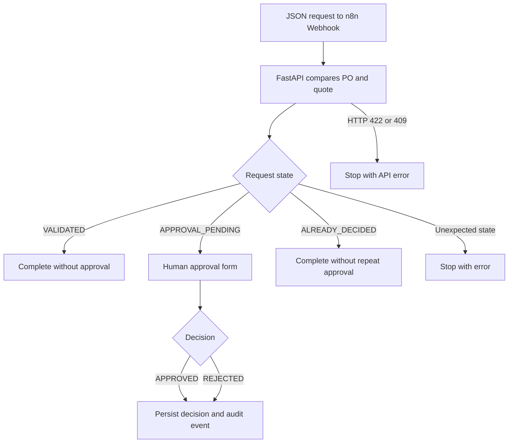

# QuoteFlow

**Purchase-order vs. supplier-quote validation with an auditable human approval workflow.**

QuoteFlow is a small end-to-end portfolio project combining **Python, FastAPI,
Pydantic, SQLite and n8n**. It validates structured purchase orders against
supplier quotes, flags business discrepancies and routes exceptions to a
human reviewer, while recording decisions and audit events.

> **Scope:** Local, reproducible MVP using fictional JSON documents. No OCR,
> PDF ingestion, production deployment or autonomous AI decisions are claimed.

## How it works



**Two workflows were built during development:** an initial manual prototype
(`QuoteFlow - Quote Validation`) proved the approval loop; **the published
`Dataset Driven` workflow** accepts arbitrary structured input and is the
portfolio deliverable.

## Features

- Checks supplier, currency, SKU presence, quantities and unit prices.
- Uses `Decimal` to compare prices and calculate totals.
- Validates input with Pydantic and handles invalid documents (HTTP 422).
- Persists requests to SQLite, with idempotent `X-Request-ID` handling (HTTP 409 on conflicts).
- Supports `APPROVED` / `REJECTED` decisions protected by an approval token.
- Maintains creation and decision audit events; prevents duplicate decisions.
- Uses n8n Webhook, Switch routing, human form and explicit error branches.

## Repository layout

```text
app/                  FastAPI, comparison, SQLite storage, approvals
scripts/              Dataset generator, QA verifier, demo Webhook client
tests/                Backend automated tests
data/synthetic/        Deterministic fictional scenarios (tracked)
workflows/            Portable n8n workflow JSON (credentials excluded)
docs/                 Architecture and design details
.github/workflows/    GitHub Actions: backend QA
```

## Quick start (Windows PowerShell)

Requirements: **Python 3.12+**, **n8n 2.47.3** (tested locally), and an n8n-compatible
Node.js installation (Node.js 24 in the development environment). Start in the
repository root.

```powershell
py -3.12 -m venv .venv
.\.venv\Scripts\python.exe -m pip install -r requirements-dev.txt
```

Generate a local approval token **outside the repository** and start FastAPI:

```powershell
$tokenFile = Join-Path $HOME '.quoteflow\approval-token.txt'
New-Item -ItemType Directory -Path (Split-Path $tokenFile) -Force | Out-Null
if (-not (Test-Path $tokenFile)) {
    .\.venv\Scripts\python.exe -c 'import secrets; print(secrets.token_urlsafe(32))' |
        Set-Content -LiteralPath $tokenFile -NoNewline
}
$env:QUOTEFLOW_APPROVAL_TOKEN = (Get-Content -LiteralPath $tokenFile -Raw).Trim()
.\.venv\Scripts\python.exe -m uvicorn app.main:app --host 127.0.0.1 --port 8000
```

Open `http://127.0.0.1:8000/docs` for the API. The default SQLite file is
`data/quoteflow.db` (gitignored); set `QUOTEFLOW_DB_PATH` to override it.

In a **separate terminal**, start your local n8n installation and import
[`workflows/quoteflow-dataset-driven.json`](workflows/quoteflow-dataset-driven.json).
Before running, select or create an **n8n Header Auth credential** with header
`X-Approval-Token` and the same value as the FastAPI token. n8n imports do **not**
include the real token; the workflow's FastAPI URLs target `127.0.0.1:8000`.
Run both services on the same Windows machine for this local setup.

For manual testing, click **Execute workflow** in n8n and wait for the test
Webhook to listen. From another terminal, send a scenario:

```powershell
.\.venv\Scripts\python.exe scripts\send_scenario.py --scenario QF-SYN-002 --unique-id
```

Open the approval form from the n8n execution, enter a decision and reviewer,
and inspect the final HTTP Request output. `--unique-id` gives every demo run a
fresh request ID; omit it to verify the `ALREADY_DECIDED` route with an existing
approved/rejected request. n8n's Webhook **HTTP 200 is only an acknowledgement**
when configured to respond immediately.

## Synthetic scenarios

| ID | Scenario | Expected |
| --- | --- | --- |
| `QF-SYN-001` | Identical documents | `VALIDATED` |
| `QF-SYN-002` | Higher laptop price | `APPROVAL_PENDING` |
| `QF-SYN-003` | Monitor quantity mismatch | `APPROVAL_PENDING` |
| `QF-SYN-004` | Missing monitor | `APPROVAL_PENDING` |
| `QF-SYN-005` | Extra docking station | `APPROVAL_PENDING` |
| `QF-SYN-006` | Supplier mismatch | `APPROVAL_PENDING` |
| `QF-SYN-007` | Currency mismatch | `APPROVAL_PENDING` |
| `QF-SYN-008` | Invalid quantity | HTTP `422` |
| `QF-SYN-009` | Duplicate SKU | HTTP `422` |

**Why synthetic data?** Real commercial POs and supplier quotes may be
confidential. Fictional but realistic records let us cover controlled error
cases, repeat tests and document results openly. This does not imply that
synthetic data is universally preferable to real-world documents. Processing
real documents would be a separate, optional extension.

## Test and verify

```powershell
.\.venv\Scripts\python.exe -m pytest -q -p no:cacheprovider tests
.\.venv\Scripts\python.exe scripts\verify_synthetic_data.py
```

In the Windows development environment, pytest required `--basetemp` pointed
to a writable custom directory because of local temp-folder permissions.
The synthetic verifier uses an isolated temporary SQLite database; it does
**not** alter your main `data/quoteflow.db`.

**Verified in the development environment:** 14 automated tests passed; all 9
synthetic scenarios passed; replay/idempotency, conflicts and SQLite audit
integrity passed. GitHub Actions repeats the automated checks on push/PR.

## Limitations and roadmap

This is an intentionally local MVP. The Webhook is not authenticated, does not
return synchronous processing results, and should **not** be exposed to the
public internet in this configuration. For another computer, update the local
URLs and reconfigure credentials. Potential extensions: PDF/OCR ingestion,
notification integrations, bulk-processing/performance tests and AI-assisted
extraction. None of these are required for the current demonstrator.

More detail: [Architecture and design](docs/ARCHITECTURE.md).
