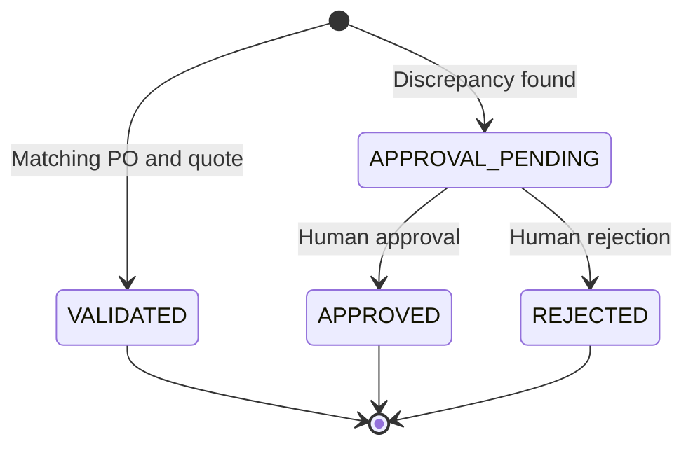

# Architecture and design notes

QuoteFlow is a **local demonstration system** for structured purchase-order (PO)
and supplier-quote validation. It does not read PDFs or perform OCR.

## Components

| Component | Responsibility |
| --- | --- |
| `app/main.py` | Pydantic models, FastAPI routes and comparison rules |
| `app/storage.py` | SQLite requests, payload hashes and creation audit events |
| `app/approvals.py` | Approval state transitions, decision records and audit events |
| `data/synthetic/scenarios.json` | Nine deterministic, fictional test scenarios |
| `scripts/` | Dataset generation, QA and a demo Webhook client |
| `workflows/quoteflow-dataset-driven.json` | n8n orchestration and human approval form |

## State machine

`POST /requests` uses `X-Request-ID` as an idempotency key. For an existing ID,
the same canonical JSON payload returns the **current** stored state and
comparison; a different payload returns HTTP 409. A repeated identical human
decision returns `replayed: true` without writing another audit event.

## API contract

| Endpoint | Purpose |
| --- | --- |
| `GET /health` | Health check |
| `POST /compare` | Stateless PO-vs-quote comparison |
| `POST /requests` | Compare and persist a request (`X-Request-ID`) |
| `GET /requests/{request_id}` | Retrieve the current state and comparison |
| `POST /requests/{request_id}/decision` | Apply `APPROVED` or `REJECTED` with `X-Approval-Token` |

Validation problems return HTTP 422. A reused ID with different content or an
invalid state transition returns HTTP 409. The decision route requires an
approval token, and refuses decisions without one configured.

## n8n behavior and limitations

The main n8n workflow receives JSON from the `quoteflow-intake` Webhook,
requests a comparison from FastAPI, routes `VALIDATED`, `APPROVAL_PENDING`,
and `ALREADY_DECIDED`, and fails explicitly for unexpected states or API
errors. The pending branch displays an approval form and saves the decision.

**The local Webhook responds immediately.** Its HTTP 200 confirms receipt by
n8n, **not** successful validation, approval or completion. Inspect the n8n
execution or query `GET /requests/{request_id}` for the outcome.

The exported workflow is intentionally **inactive**, uses local API URLs
(`127.0.0.1:8000`), and omits installation-specific credentials. On import,
select a Header Auth credential with header `X-Approval-Token` and the token
configured in the FastAPI process. This is a local portfolio MVP, not a
hardened internet-facing application.
